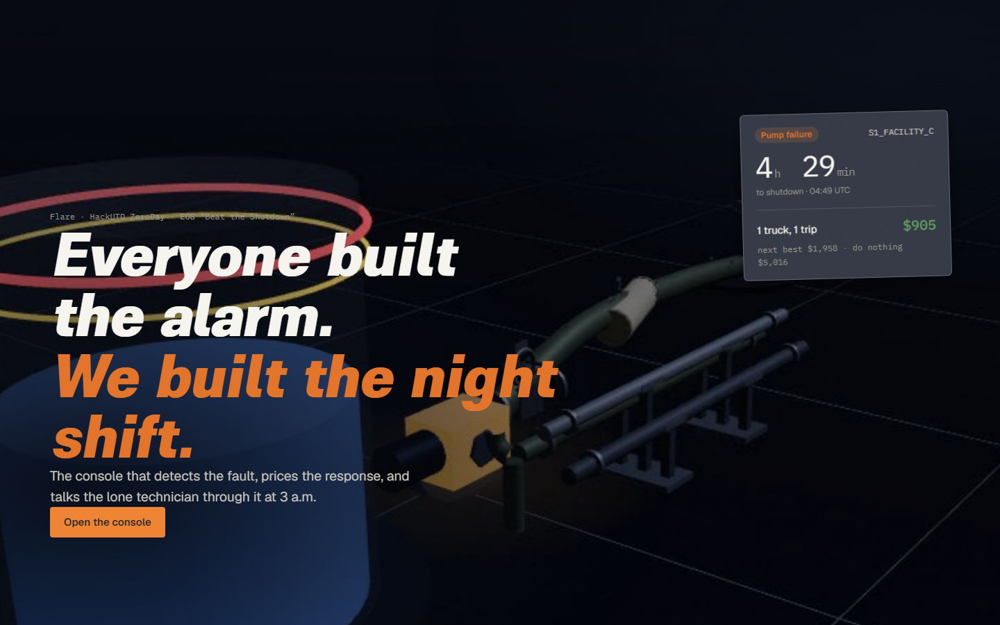
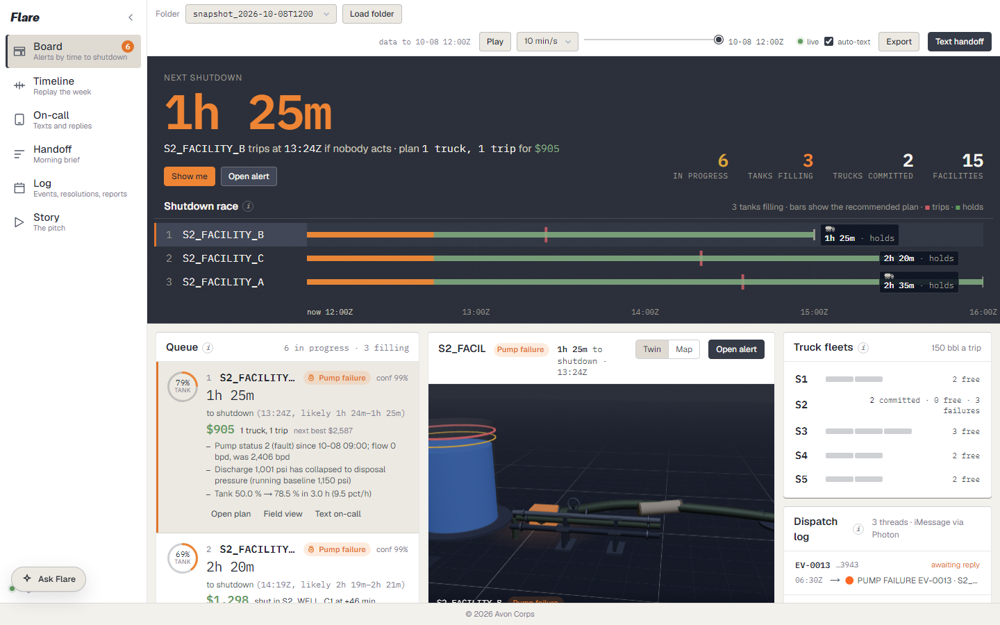
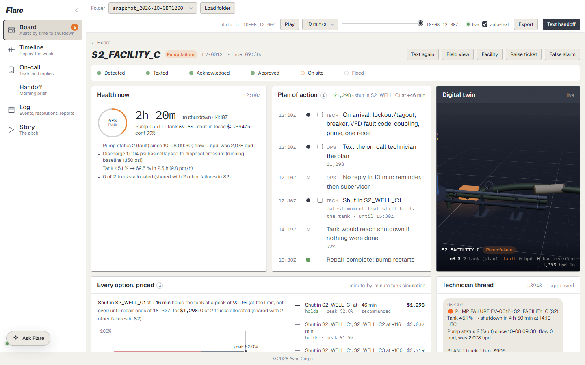
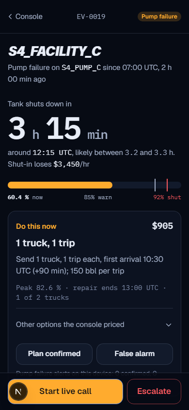

# Flare

  


**The night shift for a produced-water network.** Detect the fault from telemetry, price the cheapest response before the tank trips, and put that plan in the hands of the operator, the lone technician, and the morning crew.



## Overview

Avon’s wells produce salt water along with oil. That water sits in a tank until a pump sends it down a pipeline to a disposal site. If the pump fails overnight, the tank climbs until the facility shuts itself in and the oil stops.

EOG’s challenge is to catch that from sensor data alone, and to choose the cheapest way to hold the tank: send trucks, shut in a well early, or do nothing. Several failures in one area share the same trucks. The only inputs are three files in a folder — `network.json`, `ops.json`, and `telemetry.csv` — and an unseen folder has to work with no code changes.

Flare is the console for that night. It reads whichever folder you load, shows what is about to shut down, prices the response, and texts the person who has to go. The technician can open the same plan on a phone, talk it through with Gemini Live, or run the call from Ray-Ban Meta glasses. In the morning the crew gets a short brief, and what happened overnight is kept so the next night warns a little earlier.


## Key features

**See the network.** The board leads with the next shutdown, then a queue ordered by how soon each tank trips. A 3D twin shows the tank, pump, and pipeline. A map shows facilities, truck yards, and disposal sites. Scrub the clock to replay the week, or ask “what if another pump failed, or we had one fewer truck?”

**Price the response.** For each pump failure, Flare simulates the tank through the repair window and compares trucks, well shut-ins, and doing nothing. Trucks already sent to a neighboring facility are not counted as free. Leaks and worn pumps get an inspection instead of a countdown. Every number on the board comes from the folder you loaded.

**Talk the technician through it.** The phone page shows the countdown, the plan, and a checklist. Start a live call and Gemini can see the camera, hear the question, and answer from that facility’s readings and runbook. A photo works when the live call cannot. Ray-Ban Meta glasses can be the camera and the earpiece. The operator watches the same conversation, the checklist, and the incident report fill in as the technician works.

**Reach people where they already are.** The alert goes out as an iMessage, with Discord as a backup. The technician can reply YES, OMW, HELP, or FIXED. If nobody answers, a supervisor is paged, sooner when the tank is closer to the limit. The same yes-or-no is available on the console, on the phone, and on an optional voice call with an AI night engineer. At the end of the shift, the morning crew gets the brief.

**Remember the night.** Closing an incident can open a GitHub ticket with the evidence and photos. A nightly job reads those outcomes, retunes how early Flare warns, and opens a pull request when something changed. The app still runs if that database and those keys are empty.


## Demo

The shots below are the console, the alert, the technician’s phone, and a glasses session. The glasses frame is from the iOS simulator (a stand-in camera, not a paired pair of glasses). Steps for a live demo are in [docs/DEMO.md](docs/DEMO.md). The device checklist for real glasses is in [docs/glasses-live.md](docs/glasses-live.md).







## System architecture

Sensors come in, the cheapest safe plan goes out, and the message lands with the person who can act.


The console does the detection and the planning in the browser, from the three data files. The server’s job is to text people, mint a short-lived Gemini session (the API key never goes to the phone), and save what the technician decides. Camera and microphone audio go from the phone or the glasses straight to Gemini. Tiger Data is optional storage for telemetry, transcripts, and tickets. Photon sends the iMessage and can host the voice agent.

A step-by-step picture of one night is below. The times and dollar amounts on it are from the 8 Oct 12:00 practice snapshot, computed from that folder’s files.


## Technology stack

| | |
| --- | --- |
| Frontend | Next.js, React, TypeScript, Tailwind. Charts, a map, and a 3D twin of each facility. |
| Backend | The same Next.js app. API routes for data folders, Gemini, texts, tickets, and the live incident page. |
| AI | Gemini Live for the field call and the glasses. A small model, trained in this repo, warns about leaks and wear before the rules fire. Optional ElevenLabs voice agent. |
| Hardware | The technician’s phone browser. Ray-Ban Meta glasses through an iPhone app in this repo. |
| Database | Tiger Data (TimescaleDB), optional. The console works without it. |
| Messaging | Photon for iMessage. Discord if Photon is not configured. GitHub issues for tickets. |

## End-to-end workflow

1. **Load a folder.** Pick one in the console, or drop `network.json`, `ops.json`, and `telemetry.csv` on the board. “Now” is the last reading in the file.
2. **See what is wrong.** Pump failures, leaks, and worn pumps show up with a plain-English reason. Failures get a countdown to shutdown.
3. **Take the cheapest plan.** The board shows the recommendation and the options it turned down, including how the trucks are shared.
4. **Send it.** The on-call technician gets a text with the countdown, the cost, and a link. They reply in a word or two. No reply, and a supervisor is paged.
5. **Walk the job.** On the phone, or through the glasses, Gemini follows the runbook for that facility. The operator sees the transcript, the checklist, and the notes.
6. **Close it out.** Mark it fixed, attach what was found, and raise a ticket if a mechanic still needs to look. The morning handoff is the same summary the crew can be texted.

## Getting started

Requires Node.js 22 or newer and npm. The board, the detector, and the plans run with no API keys. Add a Gemini key when you want the live call. Texts, the database, tickets, and the voice agent turn on when those keys are filled in.

```bash
git clone https://github.com/Siriapps/HackUTD-26.git
cd HackUTD-26
npm install
cp .env.example .env.local
npm run dev          # http://localhost:3000
npm test
```

Open the folder switcher and try `snapshot_2026-10-08T1200` (three failures sharing two trucks) or `full_week`. On judging day, drop the unseen folder in `public/data/test/` or drag the three files onto the board.

Put `GEMINI_API_KEY` in `.env.local` for the live call and Ask Flare. Every other name, and which ones can stay blank, is listed in [.env.example](.env.example).

To open the console from a phone on a locked-down Wi-Fi network, leave the laptop on localhost and run a Cloudflare tunnel in a second terminal (`brew install cloudflared`):

```bash
cloudflared tunnel --protocol http2 --url http://127.0.0.1:3000 --no-autoupdate
```

Paste the printed `https://….trycloudflare.com` address into the phone.

### iPhone App

The Ray-Ban Meta client is its own Xcode project. Start the web console first, with `GEMINI_API_KEY` set, because the phone asks that server for the Gemini session.

You need a Mac with Xcode 26.4 or newer, an iPhone on iOS 17.2 or newer, and an Apple Developer team so the app can be signed. A free Personal Team is enough for this Bluetooth build. Pair the glasses in the Meta AI app, then turn on Developer Mode there: Settings → App Info → tap the version five times → Enable.

```bash
npm run dev -- -H 0.0.0.0
open experiments/meta-sdk-poc/ios/CameraAccess.xcodeproj
```

In Xcode, select the CameraAccess target, open Signing & Capabilities, choose your team, and change the bundle id to one you own. Select your iPhone (a simulator cannot see the glasses) and press Run. Allow Bluetooth, Local Network, and Microphone.

On the phone, set the server to `http://<your-mac>.local:3000`. The Mac’s name is `scutil --get LocalHostName`. Check it in Safari on the phone by opening `http://<name>.local:3000/api/gemini/glasses`. You should see `"configured": true`. If the page does not load, allow incoming connections for `node` in the macOS firewall.

Wear the glasses. If the app says to connect them, approve the prompt in Meta AI. On the Flare screen, pick an event such as `FIX-LEAK`, leave the mic path on DAT PCM, and tap Start Live. The full device checklist is in [docs/glasses-live.md](docs/glasses-live.md).

## Project structure

```
src/            the console, the field page, and the detection engine
public/data/    network folders you can load
experiments/    the iPhone app for Ray-Ban Meta glasses
docs/           demo script, glasses notes, and design
images/         the architecture diagrams above
```

More detail lives in [docs/DEMO.md](docs/DEMO.md), [docs/glasses-live.md](docs/glasses-live.md), [docs/VERIFY.md](docs/VERIFY.md), and [docs/DESIGN.md](docs/DESIGN.md). [docs/PLAN.md](docs/PLAN.md) is the original build plan.

## Artifacts

- DevPost: https://devpost.com/software/bee-movie-script

## Team and acknowledgments

Huge thank you to HackUTD, EOG Resources, and teams behind Gemini Live API, the Meta Wearables Device Access Toolkit, Photon, ElevenLabs, MLH and Tiger Data.   


Shoutout to Nathan Han for loaning the Meta RayBan glasses for the weekend!

**Team Flare:**  

- Deeksha Bandi  
- Advay Chandramouli
- Siri Appalaneni
- Zoe Bryant
