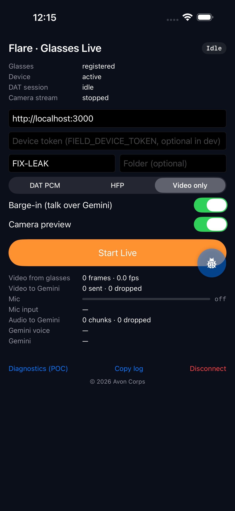
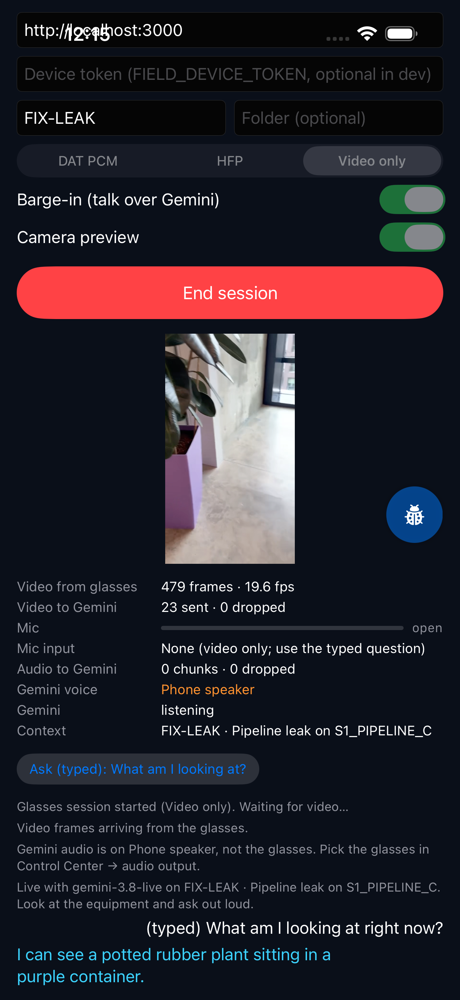
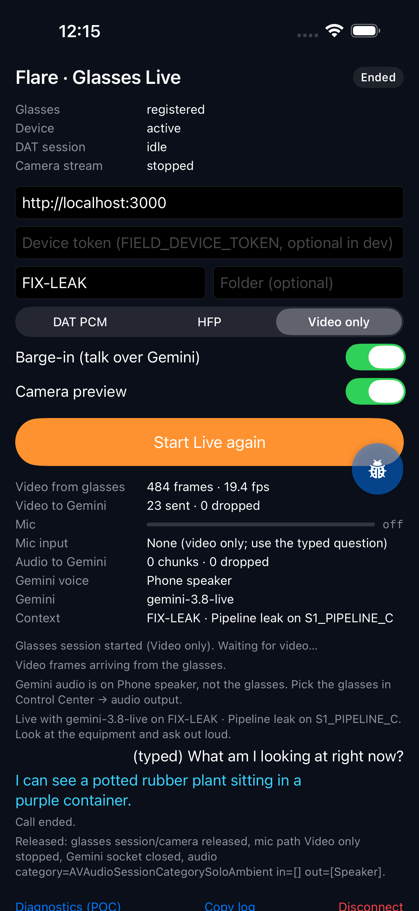

# Flare Live on Ray-Ban Meta glasses

A field technician wearing Ray-Ban Meta (Gen 2) glasses looks at equipment, asks a question out loud, and hears Gemini
Live answer through the glasses, with the same facility briefing, tools and incident memory as the web `/field` page.

- Native app: `experiments/meta-sdk-poc/ios` (the DAT feasibility POC, now with a **Flare Live** screen; the original
  diagnostics screen is one tap away and unchanged).
- Server: `POST /api/gemini/glasses` (`src/app/api/gemini/glasses/`).
- The web `/field` page and its phone camera are untouched.

  

_Simulator + MockDeviceKit (plant video, not glasses video), video-only path with a typed question._

## Verification status

| What | Status | How |
| --- | --- | --- |
| Server route mints a token and the same `setup` frame `@google/genai` sends | **Automated** | `src/app/api/gemini/glasses/session.test.ts` captures the SDK's real frame over a local WebSocket and compares |
| Gemini Live accepts the native protocol: setup, 16 kHz PCM in 40 ms chunks, 1 fps JPEG, typed text, tool round-trip, spoken 24 kHz reply | **Verified against the real API** (raw-wire script) | spoken question was transcribed, the answer cited the frame and `S1_PIPELINE_C`, `log_observation` round-tripped, follow-up answered in the same session |
| The app's Swift client (`FlareBackend` + `GeminiLiveClient` + `PCM16Converter` + `FrameSampler`) against real Gemini | **Verified in the iOS simulator** | `FlareLiveE2ETests`: 17 frames sent / 0 dropped, 109 mic chunks, question transcribed, 10 s spoken answer |
| DAT stream → POC decoder → sampler → Gemini, full app UI | **Verified in the simulator with MockDeviceKit** | `FlareLiveUITests`: 23 frames sent / 0 dropped; Gemini: "I can see a potted rubber plant sitting in a purple container" (the mock feed) |
| Pure pieces: echo gate, frame sizing/backpressure, PCM conversion, server-message parsing | **Automated** | `FlareLiveTests` (12 tests) |
| Real glasses video, glasses mic (PCM / HFP), playback through the glasses speakers, simultaneous duplex audio | **Not yet verified on a physical iPhone + glasses** | run [Physical-device test](#physical-device-test) |

MockDeviceKit has no in-stream PCM: with `DAT PCM` selected the mock stream ends with "operation timed out" after a
few seconds, which is why the simulator run uses `Video only`. Treat that as a mock limitation, not evidence about the
glasses.

## Architecture

```
Ray-Ban Meta ── DAT (Bluetooth Classic) ──▶ iPhone app (experiments/meta-sdk-poc/ios, FlareLive/)
  camera hvc1 24 fps ─▶ VideoFrameDecoder (POC) ─▶ FrameSampler: newest frame, 1 fps, ≤768 px, JPEG 0.6 ─┐
  mic: DAT in-stream PCM 16 kHz  (or HFP via AudioInputHandler, POC) ─▶ PCM16Converter 40 ms ─▶ EchoGate ─┤
                                                                                                           ▼
  Night Shift server  POST /api/gemini/glasses ──(token + setup frame + event + incidents)──▶  GeminiLiveClient
    builds EventContext, buildBriefing + glasses rules,                                        wss://…BidiGenerateContentConstrained
    FIELD_TOOLS, single-use ephemeral token (API key stays here)                                 │        ▲
  POST /api/notify ◀── confirm_plan / escalate tool calls (same body as the web page) ──────────┘        │
                                                                                                          │
  LiveAudioPlayer (24 kHz) ◀── modelTurn audio ── Gemini Live ◀───── realtimeInput audio + video ────────┘
     └─▶ AVAudioSession route: Bluetooth A2DP (DAT PCM) or the HFP link (HFP) → glasses speakers, verified on screen
```

### Why a native Gemini client with a server-built session

- DAT is a native SDK; the browser cannot see the glasses camera or microphone.
- The web page already connects browser → Gemini directly with a single-use token minted by the server. The native app
  does the same, so there is exactly **one** Gemini session per call and no media relay to secure or scale.
- The browser builds the briefing from data it loaded; the phone app cannot run `analyse()`. So the new route builds the
  same `EventContext` on the server (`serverDataset` / `serverAnalysis` / `eventContext`, or the `FIX-*` fixtures), runs
  the same `buildBriefing` + `similar` + `FIELD_TOOLS`, appends the glasses vision rules, and locks all of it into the token.
  It also returns the exact `setup` frame, so the app never re-implements the SDK's config mapping (a unit test keeps it
  byte-identical to `@google/genai`).
- Rejected: a native→server media bridge (adds a relay, latency and an endpoint to protect) and a WKWebView hosting
  `/field` with injected media (WebKit owns its own audio session, which fights the HFP/A2DP routing we need, and it
  would require changing `LiveSession.tsx`).

### Media path details

| | Choice | Why |
| --- | --- | --- |
| Video in | DAT `hvc1 / .low / 24 fps` (the POC's verified config), every frame decoded by the POC's `VideoFrameDecoder` | HEVC frames depend on their predecessors, so sampling happens after decode |
| Sampling | Newest frame only, 1 fps (server-configurable `media.videoFps`), long edge ≤ 768 px, aspect ratio kept, JPEG 0.6 | Gemini Live reasons over ~1 fps; ~30–60 KB per frame |
| Backpressure | Frame dropped if the previous one is still in flight, if >150 KB is queued, or if it is >2 s old (stalled stream). Audio dropped only past ~450 KB queued. Counters on screen. | Freshness over completeness; a slow uplink never grows latency |
| Mic in | DAT PCM: Float32 16 kHz mono from `audioFramePublisher` → PCM16 LE, 40 ms chunks. HFP: the POC's `AudioInputHandler` tap (glasses HFP input only) resampled with `AVAudioConverter` | Gemini wants 16 kHz PCM16 |
| Turn-taking | Server VAD. `EchoGate` sends silence while Gemini is audible (+350 ms tail); 3 consecutive loud chunks (≥0.06 RMS) count as barge-in: held chunks are released and local playback stops. Toggle "Barge-in" off for strict half-duplex | Open-ear speakers sit next to the mics; without it Gemini can hear and interrupt itself |
| Audio out | 24 kHz PCM16 → `AVAudioEngine`. DAT PCM path: category `.playback` (no app mic at all, so no phone-mic fallback is possible) → A2DP when the glasses are the Bluetooth output. HFP path: the HFP link itself | The route is read back from `AVAudioSession.currentRoute` and shown; a non-glasses route is reported in orange |
| Interruptions | Calls/Siri pause the uplink and resume after; route changes are re-checked and announced; backgrounding ends the call (DAT stops the camera in the background); the idle timer is disabled during a call so the screen does not lock | |
| Reconnect | On `goAway` the app mints a new session and reconnects (up to 3 times). The briefing carries over; the conversation does not | |
| Teardown | Frame pump, socket, player, PCM listener (cancelled before the camera stops, per DAT), camera, session, HFP, audio session deactivated; the transcript prints what was released | |

### Mic path choice

- **`DAT PCM` (default)** — Meta's recommended mic path alongside the camera. Verified on device in the POC for capture.
  Beta/development release channels only (Developer Mode counts); not available on production channels.
- **`HFP`** — verified on device in the POC for capture. On current glasses firmware the glasses may **end the DAT session
  when HFP comes up** and refuse new sessions while HFP is held (DAT issue #342); the app reports that case explicitly.
  When it works, mic and Gemini audio share the HFP link (8/16 kHz voice quality).
- **`Video only`** — debug: no microphone, ask with the "Ask (typed)" button. Proves the vision path on its own.

Unverified on hardware: whether A2DP playback and the Bluetooth Classic camera stream run together without stutter or
the glasses ending the session; how much speaker echo the in-stream PCM mic picks up.

## Media-source contract (for the future camera selector)

The Live session consumes a media source; it does not care where frames come from. Native side:
`experiments/meta-sdk-poc/ios/CameraAccess/FlareLive/MediaSourceContract.swift` (`FieldMediaSource`, implemented by
`GlassesCapture`). Proposed web shape, so `LiveSession.tsx` can take either source without changing its Gemini code:

```ts
type MediaSourceKind = "phone_camera" | "meta_glasses";
interface FieldMediaSource {
  kind: MediaSourceKind;
  start(): Promise<void>;
  stop(): void;
  /** Newest frame as base64 JPEG (long edge ≤ media.videoMaxEdge), or null if stale. Polled at media.videoFps. */
  grabFrame(): string | null;
  /** 16 kHz mono PCM16 chunks for realtimeInput.audio. */
  onAudio(cb: (pcm16: ArrayBuffer, sampleRate: number) => void): void;
  /** Where Gemini's reply should play; the phone camera plays through Web Audio. */
  playback?: { enqueue(pcm16: ArrayBuffer): void; flush(): void };
}
```

Wire contract both sources already share: `realtimeInput.video` = `image/jpeg` ~1 fps; `realtimeInput.audio` =
`audio/pcm;rate=16000`; replies `audio/pcm;rate=24000`; tools `confirm_plan`, `log_observation`, `escalate`,
`get_past_incidents` answered as in `LiveSession.tsx`. Because the browser cannot reach DAT, a web "Meta glasses"
option would hand off to the native app (e.g. a deep link carrying `eventId` + `folder`) rather than stream into the page.

Follow-up issue to open (not created from this branch):

> **Field view: camera source selector (Phone camera / Meta Ray-Ban)** — Add a source picker to `/field/[eventId]`.
> "Phone camera" keeps today's `getUserMedia` path. "Meta Ray-Ban" opens the native Flare app on the same event
> (`eventId`, `folder`) and shows that call's status; the browser does not stream. Refactor `LiveSession.tsx` behind the
> `FieldMediaSource` interface in `docs/glasses-live.md` first, with no behaviour change. Labels: `w3`.

## Server route

`POST /api/gemini/glasses` with `{ "eventId": "FIX-LEAK", "folder"?: "full_week" }` returns
`{ ok, token, model, apiVersion, wsUrl, setup, expiresAt, media, folder, event, eventLabel, incidents }`.
`GET /api/gemini/glasses?folder=` returns `{ configured, model, folder, events[] }` (fixtures plus ongoing events).

The token is single-use, must open a session within 2 minutes, and lasts 30 minutes, with the model, briefing and tools
locked server-side. The phone never sees `GEMINI_API_KEY`.

## Security

- `GEMINI_API_KEY` stays on the server; the app gets a single-use ephemeral token whose config cannot be changed by the client.
- The route builds the system instruction itself; unlike `/api/gemini/token` it does not accept arbitrary prompts.
- Access: with `FIELD_DEVICE_TOKEN` set, the app must send it as `x-field-token` (enter it on the Flare screen);
  without it the route only works in development (`next dev`), like `/api/photon/send`. Set it on any deployed server.
- No relay: camera and microphone go phone → Google only. Nothing is written to disk; observation keyframes are kept in
  memory for the call and dropped at the end. Transcripts stay on screen only.
- The app allows plain HTTP only to local-network hosts (`NSAllowsLocalNetworking`) for the dev server; Gemini is always `wss://`.

## Physical-device test

**Needs:** Mac with Xcode 26.4+, iPhone with Meta AI (Developer Mode on) and the glasses paired, both on the same
Wi-Fi, `GEMINI_API_KEY` in `.env.local`.

1. **Server.** `npm run dev -- -H 0.0.0.0`. Find the Mac's name with `scutil --get LocalHostName` and open
   `http://<name>.local:3000/api/gemini/glasses` in **Safari on the iPhone**: expect `{"configured":true,…}`. If it
   does not load, allow incoming connections for `node` in macOS Firewall.
2. **App.** Open `experiments/meta-sdk-poc/ios/CameraAccess.xcodeproj`, pick your team (Signing & Capabilities), select
   the iPhone, Run. Allow Bluetooth, Local Network and Microphone prompts.
3. **Glasses.** Wear and unfold them. If the app shows "Connect my glasses", tap it and approve in Meta AI.
4. **Audio output.** Control Center → audio output → choose the glasses (needed for A2DP playback on the DAT PCM path).
5. **Flare screen.** Server `http://<name>.local:3000`, event `FIX-LEAK` (pipeline-leak scenario; or any event id from the
   GET above), mic path **DAT PCM**, Barge-in on, preview on. Device must read `active`.
6. **Start Live.** On the first run Meta AI opens for camera, then microphone permission; approve and return. If the
   call ended during that hop, tap Start Live again.
7. **Check the status block before talking:**
   - transcript: "Video frames arriving from the glasses", then "Gemini audio → Bluetooth A2DP · Ray-Ban Meta", then "Live with …";
   - "Video from glasses" increasing; "Video to Gemini" increasing about 1 per second with few drops;
   - "Mic" bar moves when you speak; "Audio to Gemini" increasing ~25 chunks/s.
8. **Hands-free.** Put the phone down with the app open (the screen stays on). Look at a pipe or fitting about 1 m away and ask:
   1. "What am I looking at?" — answer should name visible parts and colours.
   2. "Do you notice anything unusual about this pipe?" — "I can see…" vs "that could be…", nothing confirmed from the picture.
   3. "What should I inspect next?" — a step from the pipeline-leak runbook / FIX-LEAK evidence.
   4. "Log an observation: the flange looks wet." — transcript shows `Logged: …`, Gemini confirms.
   5. "What happened last time this leaked?" — Gemini uses `get_past_incidents`.
   6. Talk over Gemini mid-answer — it should stop and listen. If Gemini keeps cutting itself off, turn Barge-in off and retry.
   (Skip "escalate"/"confirm the plan" unless you want a real message on the configured Photon/Discord channel.)
9. **Prove the video path, not the preview.** Cover the camera with your hand and ask "What do you see now?" — the answer
   must change. Optionally switch to **Video only** and use "Ask (typed)".
10. **End session.** Transcript prints `Released: glasses session/camera released, … Gemini socket closed, audio …`; the
    glasses capture LED goes off; the iOS orange/green privacy dot disappears.
11. **HFP run.** Force-quit the app (Classic stream memory, DAT #324), choose **HFP**, repeat steps 6–10. Expected on some
    firmware: "The glasses ended the session when Bluetooth HFP opened" (DAT #342) — record it.
12. **Phone camera regression.** On the iPhone, open `http://<name>.local:3000/field/FIX-LEAK` in Safari, tap
    "Start live call", ask a question: the existing phone-camera path must work as before.
13. Tap **Copy log** after each run and attach it with the results.

Acceptance (fill in from the device run): glasses connect · frames arrive · frames reach Gemini (step 9) · Gemini describes
the object · glasses mic reaches Gemini · reply plays on the glasses · several follow-ups without restart · tools usable ·
End releases camera/mic/network · phone camera unchanged.

## Limitations

- In-stream PCM is beta/development-channel only; a production Meta release channel would need HFP (and the #342 firmware fix).
- Bluetooth Classic streaming is development-only (App Store needs MFi); Classic heap grows per stream (DAT #324): restart the app between long tests.
- Backgrounding or locking the phone ends the call.
- Reconnect after `goAway` starts a fresh conversation (same briefing).
- `log_observation` keeps the note and keyframe in the app only; the web page's localStorage memory and visual report do not see them.
- `confirm_plan` / `escalate` go wherever `/api/notify` sends (Photon, else Discord), exactly as from the web page. They were not exercised in testing to avoid posting to the team channel.
- Echo-gate thresholds are first guesses; tune `EchoGate.bargeInRms` after the device run.
